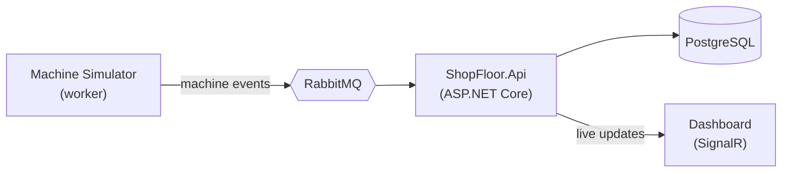

# ShopFloor

[](https://github.com/JanekBoron/ShopFloor/actions/workflows/build.yml)


**Production monitoring backend for a manufacturing shop floor, built with ASP.NET Core (.NET 10).**

Machines on production lines report events: completed cycles, downtime and scrapped parts. ShopFloor collects those events and calculates **OEE** (Overall Equipment Effectiveness) per line and shift:

> **OEE = Availability × Performance × Quality**

The idea comes from my work on Manufacturing Execution Systems (MES), where OEE is one of the key metrics for production teams.

## Status

The project is in early development. Planned milestones:

- [x] Web API skeleton: production lines, EF Core with PostgreSQL, Docker Compose, CI
- [ ] Machines and work orders
- [ ] Machine simulator publishing events to RabbitMQ
- [ ] OEE calculation per line and shift
- [ ] Transactional outbox and idempotent consumers
- [ ] Observability with OpenTelemetry
- [ ] Live dashboard with SignalR
- [ ] Authentication with JWT

## Architecture (planned)



## Tech stack

| Area | Technologies |
| --- | --- |
| API | ASP.NET Core minimal APIs, built-in validation, ProblemDetails, OpenAPI with Scalar |
| Data | Entity Framework Core 10, PostgreSQL (Npgsql) |
| Testing | xUnit v3, `WebApplicationFactory`, Testcontainers (real PostgreSQL in Docker) |
| Tooling | Docker, Docker Compose, GitHub Actions, central package management |

## Project structure

```
src/
  ShopFloor.Domain/              domain model (no framework dependencies)
  ShopFloor.Api/                 HTTP API, EF Core persistence, endpoints grouped by feature
tests/
  ShopFloor.Domain.Tests/        unit tests for domain rules
  ShopFloor.Api.IntegrationTests/  API tests against PostgreSQL in a container
```

## Running locally

Requirements: Docker. For development without containers you also need the .NET 10 SDK.

**Everything in Docker:**

```bash
docker compose up --build
```

The API starts on http://localhost:8080 and applies database migrations on startup. API reference: http://localhost:8080/scalar.

**API from the IDE, database in Docker:**

```bash
docker compose up -d postgres
dotnet run --project src/ShopFloor.Api
```

The API starts on http://localhost:5020. Example requests are in [`ShopFloor.Api.http`](src/ShopFloor.Api/ShopFloor.Api.http).

## Tests

```bash
dotnet test --solution ShopFloor.slnx
```

Integration tests need a running Docker engine: Testcontainers starts a throwaway PostgreSQL instance for them.

## API

| Method | Endpoint | Description |
| --- | --- | --- |
| `GET` | `/health` | Health check, including the database connection |
| `GET` | `/api/lines` | List production lines |
| `GET` | `/api/lines/{id}` | Get a production line |
| `POST` | `/api/lines` | Create a production line (`409` if the code is taken) |

## License

[MIT](LICENSE)
